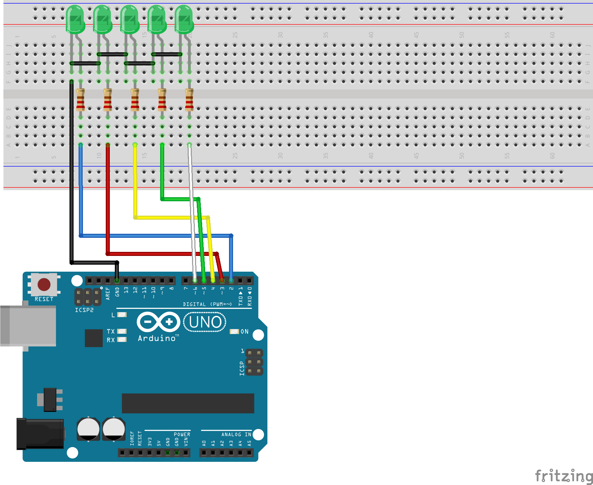
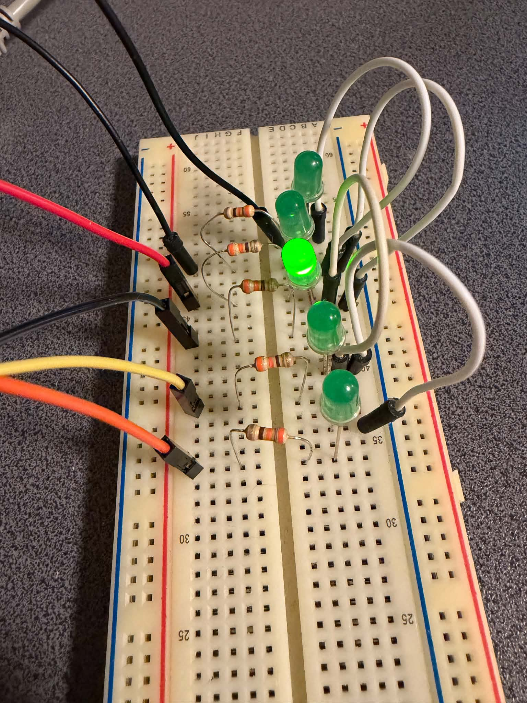
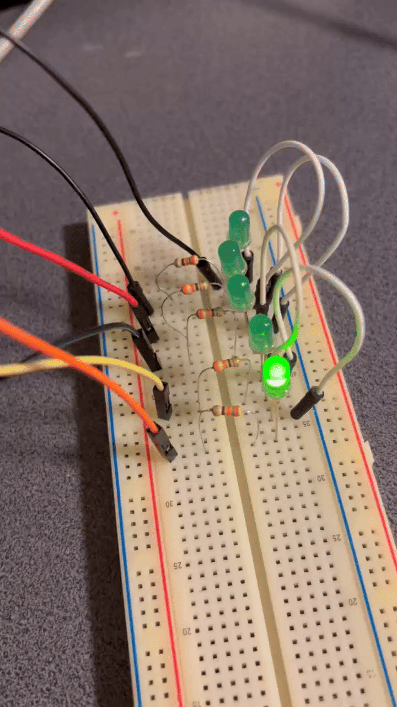

# Project: LED Wave Effect (KITT Scanner) with Arduino Uno

This project implements a sequential LED wave effect (inspired by the KITT scanner) using an Arduino Uno and five LEDs. Each LED lights up and turns off in sequence from left to right and back again, introducing digital outputs, current-limiting resistors, and clean timing control.

## Components Used
- Arduino Uno
- 5x LEDs (e.g., Red 5mm LEDs)
- 5x Current-Limiting Resistors (560 Ohm as in the reference project, or 220–330 Ohm)
- Breadboard and Jumper Wires
- USB Cable (for power and programming)

## Circuit Diagram
The following diagram illustrates the wiring between the Arduino digital output pins, the current-limiting resistors, the LEDs, and common ground.

### Pin Mapping
| Component | Arduino Pin | Breadboard / Function |
| :--- | :--- | :--- |
| LED 1 (Anode +) | Digital Pin 2 | Via current-limiting resistor to LED 1 anode |
| LED 2 (Anode +) | Digital Pin 3 | Via current-limiting resistor to LED 2 anode |
| LED 3 (Anode +) | Digital Pin 4 | Via current-limiting resistor to LED 3 anode |
| LED 4 (Anode +) | Digital Pin 5 | Via current-limiting resistor to LED 4 anode |
| LED 5 (Anode +) | Digital Pin 6 | Via current-limiting resistor to LED 5 anode |
| All LEDs (Cathode -) | GND | Connected to the common GND rail |

## How It Works
Each digital pin (2 through 6) is configured as an `OUTPUT` in `setup()`. In `loop()`, the Arduino drives one pin `HIGH` (approx. 5 V) at a time, allowing current to flow through the resistor and LED to `GND`, waits for a set delay, turns that pin `LOW` (0 V), and moves to the next LED.

### Current Limiting & Polarity
LEDs are polarized components—current must flow from the **anode** (longer leg) to the **cathode** (shorter leg / flat edge on the housing). A series resistor limits current according to Ohm's law so neither the LED nor the Arduino I/O pin (max 40 mA per pin on Arduino Uno) is overloaded.

## Setup Instructions
1. Place the five LEDs on the breadboard, connecting each **cathode** (shorter leg) to the common `GND` rail and wiring that rail to Arduino `GND`.
2. Connect a current-limiting resistor to each LED's **anode** (longer leg), bridging across the center channel of the breadboard.
3. Wire the free ends of the five resistors to Arduino digital pins `2`, `3`, `4`, `5`, and `6` in order.
4. **Important:** Double-check LED polarity before powering up—reversing an LED blocks current, and omitting resistors can damage components.
5. Connect the Arduino Uno to your computer via USB and upload the LED wave sketch.
6. Observe the wave sweeping back and forth, then experiment by changing the delay time or using a variable/loop to simplify the sequence.

